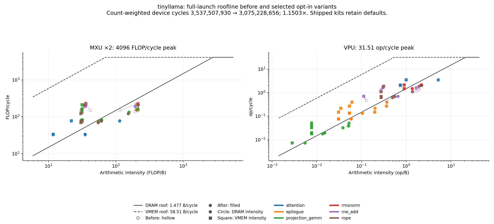
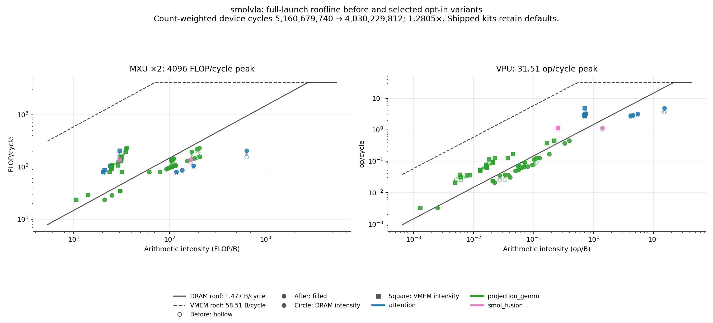

# Roofline after opt-in variants

The current measured selection covers all 54 full-shape launch kinds in the [TinyLlama](examples/tinyllama/MODEL-BENCH.md) and [SmolVLA](examples/smolvla/MODEL-BENCH.md) inventories: 26 and 28 kinds, respectively. It selects 22 opt-in kinds and retains 32 defaults. These opt-in programs are not used by the shipped kits. Measurements qualify the schedules at `926c6f3248e70d7cfdbf9adb664d7da000ce03f4`; they have not been repeated for subsequent kernel changes.

## Model totals

| Model | Device cycles before | Device cycles after | Saved cycles | Reduction | Speedup | SOL fraction before | SOL fraction after | Remaining headroom |
| --- | ---: | ---: | ---: | ---: | ---: | ---: | ---: | ---: |
| TinyLlama | 3,537,507,930 | 3,075,228,656 | 462,279,274 | 13.07% | 1.150324x | 73.03% | 78.42% | 663,542,917 |
| SmolVLA | 5,160,679,740 | 4,030,229,812 | 1,130,449,928 | 21.91% | 1.280493x | 52.69% | 66.76% | 1,339,642,381 |

Totals are sums of measured full device launches times their inventory counts, not whole-model timings. Host work, program loading, launch overhead, runtime completion-marker timing, and operations outside the device inventory are excluded. No query-subset estimate enters these totals. Full vision attention measures 26,092,660 cycles before and 19,752,187 after, across 24 launches. Replacing the older 42,757,416-cycle extrapolation removes 399,954,144 cycles from the old SmolVLA baseline; this correction is separate from the optimization savings above.

## Remaining headroom by family

SOL is the largest per-launch resource charge from the speed-of-light API. Family and model SOL fractions are `sum(SOL cycles * count) / sum(measured cycles * count)`, not averages of launch percentages. Headroom is `sum((measured after - SOL after) * count)`: a theoretical upper limit for scheduling the selected work, not expected savings. Dependencies can prevent reaching it. Bounds are recomputed when a variant changes resource work.

| Model / family | Binding resources after | SOL cycles after x count | Measured cycles after x count | SOL fraction after | Remaining headroom |
| --- | --- | ---: | ---: | ---: | ---: |
| SmolVLA / projection_gemm | DRAM | 2,013,763,255 | 2,561,454,412 | 78.62% | 547,691,157 |
| SmolVLA / attention | DRAM, VPU | 204,010,352 | 632,088,168 | 32.28% | 428,077,816 |
| SmolVLA / smol_fusion | DRAM | 472,813,824 | 836,687,232 | 56.51% | 363,873,408 |
| TinyLlama / epilogue | DRAM | 1,146,495,174 | 1,466,034,548 | 78.20% | 319,539,374 |
| TinyLlama / rne_add | DRAM | 290,895,198 | 412,336,936 | 70.55% | 121,441,738 |
| TinyLlama / projection_gemm | DRAM | 665,493,995 | 769,819,638 | 86.45% | 104,325,643 |
| TinyLlama / rope | DRAM | 236,838,800 | 312,964,894 | 75.68% | 76,126,094 |
| TinyLlama / rmsnorm | DRAM | 52,710,020 | 75,488,820 | 69.82% | 22,778,800 |
| TinyLlama / attention | DRAM | 19,252,552 | 38,583,820 | 49.90% | 19,331,268 |

Resource labels describe the binding resources of individual launches, not a combined family roof. Count-weighted SOL totals before and after are 2,583,490,471 and 2,411,685,739 cycles for TinyLlama, and 2,719,196,967 and 2,690,587,431 for SmolVLA. The largest remaining opportunities are SmolVLA projections, attention, and fused vision fc1, followed by TinyLlama epilogues.

## Plots

Each point represents one full launch kind without count weighting. Hollow points are before, filled points are after, circles use DRAM intensity, and squares use VMEM intensity. Panels show MXU and VPU work separately. Solid and dashed lines are the DRAM and VMEM roofs; counts affect the tables, not point placement.

## Method and selection

The analysis uses unmodified `npu_model` at `74982e7c68bd28ba6505b4df37290f198102ccce`, specifically `npu_performance.speed_of_light.speed_of_light` and `npu_performance.roofline.measure`, with `DefaultHardwareConfig`, `numerics="pytorch"`, and default curve memory. This differs from the RTL numerics used by [bench_model.py](bench_model.py). Before combines 53 authenticated full-launch receipts with one fresh original 1024-query vision execution. After uses 22 fresh variant executions and the same 32 default receipts. A validated execution memo supplies the same measured dynamic counters to both APIs; their cycles, MXU FLOPs, and DRAM bytes agree exactly. Source, arena, assembled-word, tool, and checkpoint hashes were checked for every launch. These measurements do not establish new RTL correctness, whole-model accuracy, or host performance.

The selection uses [vision-fast](../kernels/attention/VISION-FAST.md) for full vision attention; [halt-delay removal](../kernels/attention/HALT.md) for the other six attention kinds; [TinyLlama fused prefill](../kernels/projection_gemm/TINY-FAST.md) for five 128-row fused kinds; [SmolVLA projections](../kernels/projection_gemm/SMOL-FAST.md) for eight admitted plain projection kinds; and [pipelined GEMM](../kernels/projection_gemm/GEMM-FAST.md) for plain 128x2048x2048 and fused 128x768x3072. Defaults cover the other shapes. Rejected 32-row probes and unsupported projection shapes are excluded. Vision-fast has a newly measured 5,622,144-cycle VPU bound; the TinyLlama down projection has a newly measured 4,747,681-cycle DRAM bound after reducing traffic from 12,779,520 to 7,012,352 bytes.

Standalone [BF16 residual](../kernels/rne_add/README.md), [policy SiLU](../kernels/epilogue/README.md#opt-in-contiguous-silu-times-up-stream), and [RoPE streams](../kernels/rope/README.md#opt-in-standalone-bf16-launch) have different staging and output contracts. They do not replace the inventoried fused launches, so no savings from those standalone programs enter these totals.

## Reproduction scope

This historical report is reproducible with the retained analysis inputs, but it is not reproducible from this checkout alone. Fresh regeneration requires the original 54 assembly programs and input arenas, launch-count manifest, variant transforms, and pinned tools and configuration. Reusing completed measurements additionally requires the authenticated receipts and execution-memo checkpoints. Those analysis artifacts are not shipped here. No small self-contained API regeneration script is provided: rerunning the current generators without verifying the original source and arena hashes would measure a different experiment. The committed plots and tables preserve the completed analysis; [bench_model.py](bench_model.py) remains the entry point for new model measurements.
