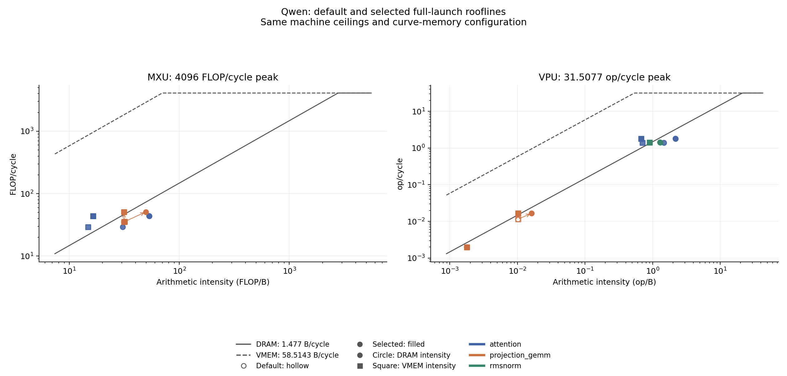

# Qwen launch roofline

The random-weight Qwen inventory covers 9 launch kinds and 18,936 launches for a 32-token prefill followed by 2 decode steps. The architecture has 28 layers, hidden width 1536, intermediate width 8960, 12 query heads, 2 key/value heads, head dimension 128, and vocabulary size 151936. These are isolated count-weighted device-launch estimates, not connected model execution or whole-model latency. Measurements qualify kernel revision `ce465827a977ba8451b585f71910726e7f12b885`; they have not been repeated for subsequent changes.

## Selected totals

| Scope | Default device cycles | Selected device cycles | Saved cycles | Speedup | Default SOL cycles | Selected SOL cycles | SOL fraction before | SOL fraction after | Selected headroom |
| --- | ---: | ---: | ---: | ---: | ---: | ---: | ---: | ---: | ---: |
| Session | 8,474,475,526 | 6,500,489,791 | 1,973,985,735 | 1.303667x | 6,424,173,379 | 4,659,789,424 | 75.81% | 71.68% | 1,840,700,367 |
| Prefill | 2,823,347,858 | 2,165,352,613 | 657,995,245 | 1.303874x | 2,140,951,097 | 1,552,823,112 | 75.83% | 71.71% | 612,529,501 |
| Decode step 1 | 2,825,563,834 | 2,167,568,589 | 657,995,245 | 1.303564x | 2,141,611,141 | 1,553,483,156 | 75.79% | 71.67% | 614,085,433 |
| Decode step 2 | 2,825,563,834 | 2,167,568,589 | 657,995,245 | 1.303564x | 2,141,611,141 | 1,553,483,156 | 75.79% | 71.67% | 614,085,433 |

The selected session estimate falls by 23.29%. SOL fraction falls because reduced DRAM traffic lowers the resource bound proportionally more than measured cycles. SOL is the largest per-launch resource charge; aggregate fractions divide count-weighted SOL cycles by count-weighted measured cycles. Headroom sums `(measured - SOL) * count` and is a theoretical scheduling upper limit, not predicted savings.

## Launch selection and coverage

Selection takes the lowest measured cycles among 15 qualified programs: 9 defaults and 6 opt-in residency programs. It uses [resident-A projection GEMM](../kernels/projection_gemm/README.md) for the two K1536 kinds and defaults for the other seven. The shipped kits do not use these opt-in variants. Resident-B and resident-B-pretranspose were measured but not selected. At K1536, the 49,152-byte A panel and 196,608-byte B panel each fit the 256 KiB residency capacity; K8960 exceeds it. Pretranspose occurs during device preload with the staged B layout unchanged.

| Kind | Physical shape | Count | Selected program | Default cycles per launch | Selected cycles per launch | Selected SOL per launch |
| --- | --- | ---: | --- | ---: | ---: | ---: |
| qwen-00 / attention | 32x32, 12/2 heads, d128, causal | 28 | default | 243,244 | 243,244 | 156,707 |
| qwen-01 / attention | 1x33, 12/2 heads, d128, causal | 28 | default | 322,386 | 322,386 | 180,280 |
| qwen-02 / attention | 1x34, 12/2 heads, d128, causal | 28 | default | 322,386 | 322,386 | 180,280 |
| qwen-03 / projection_gemm | 32x1536x128, 1 logical row | 11,782 | resident-A | 358,100 | 246,405 | 171,917 |
| qwen-04 / projection_gemm | 32x1536x128 | 5,891 | resident-A | 358,100 | 246,405 | 171,917 |
| qwen-05 / projection_gemm | 32x8960x128, 1 logical row | 672 | default | 2,056,340 | 2,056,340 | 1,558,512 |
| qwen-06 / projection_gemm | 32x8960x128 | 336 | default | 2,056,340 | 2,056,340 | 1,558,512 |
| qwen-07 / rmsnorm | 32x1536, 1 logical row, epsilon 1e-6 | 114 | default | 281,398 | 281,398 | 210,741 |
| qwen-08 / rmsnorm | 32x1536, epsilon 1e-6 | 57 | default | 281,398 | 281,398 | 210,741 |

The inventory covers 105,164,150,484 of 105,193,268,577 runtime semantic FLOPs, or 99.97% (99.972319433179% before rounding), through bias-free projection GEMM, QK/softmax/PV attention, and complete RMSNorm. Each forward has 6,227 projection panels, 28 attention launches, and 57 normalization launches. Projection panels include the vocabulary head and use full K with 128-wide output panels; decode retains 31 padded rows. Logical coverage excludes padding, while official MXU counters charge physically launched work. The corrected coverage ledger removes a historical 5,763,072-FLOP overcount of cached-decode PV work without changing launch counts or cycles.

Q/K/V bias and residual epilogues are excluded from the selected numbers: their 1,949,696 and 2,924,544 semantic FLOPs remain unmapped. Other uncovered work includes position/mask bookkeeping, RoPE, attention scale/mask glue, SiLU, SiLU(gate) times up, and greedy argmax. Separate scale/mask glue remains conservatively uncovered even though the attention kernel implements it. Embedding, layout, casts, cache concatenation, and session glue have zero assigned FLOPs and remain outside coverage. The denominator counts GEMM multiply-add as 2, softmax as 5 per output element, reductions by input elements, and other compute by output elements, including integer/mask bookkeeping; it measures semantic work, not runtime share or accuracy.

Host work, dispatch, transfers between launches, program loading, cache maintenance outside each launch, and uncovered graph operations are excluded. Count weighting does not model dependencies or cross-launch reuse.

## Remaining family headroom

| Family | Kinds | Selected device cycles | Selected SOL cycles | SOL fraction | Headroom |
| --- | ---: | ---: | ---: | ---: | ---: |
| projection_gemm | 4 | 6,427,506,285 | 4,609,269,237 | 71.71% | 1,818,237,048 |
| rmsnorm | 2 | 48,119,058 | 36,036,711 | 74.89% | 12,082,347 |
| attention | 3 | 24,864,448 | 14,483,476 | 58.25% | 10,380,972 |

All selected launches bind on the official DRAM charge. Bounds are remeasured when variants change traffic.

Points represent full launch kinds without count weighting. Hollow symbols are defaults, filled symbols are selected programs, and arrows connect changed points. Circles use DRAM intensity, squares use VMEM intensity, solid lines are DRAM roofs, and dashed lines are VMEM roofs. MXU and VPU panels use their own work definitions. Peaks are 4096 MXU FLOP/cycle, 31.5077 VPU op/cycle, 1.477 DRAM B/cycle, and 58.5143 VMEM B/cycle. SOL additionally accounts for scalar, port, issue, XLU, and LSU limits; the DRAM ceiling assumes the fastest read/write mix.

## Method, evidence, and limits

Measurements use the unmodified `speed_of_light` and `roofline.measure` APIs from npu_model `74982e7c68bd28ba6505b4df37290f198102ccce`, `DefaultHardwareConfig`, default curve memory, and `numerics="pytorch"`. The memory curve uses a 42-cycle lead-off, 23.5 cycles per 32-byte load beat, and 21.7 per store beat. Both APIs receive the same authenticated, unchanged dynamic execution memo. The execution-model package is byte-identical to `47b8599`; separate qualification uses that pinned model with `numerics="rtl"`. Official and RTL-numerics cycles agree for all 15 programs, and timed and functional outputs agree. All 10 projection programs pass independent full-extent ordered-matmul bit-exact checks. Attention and RMSNorm have no independent bit-exact golden in this analysis.

The source analysis is identified as `KPERF-QWEN`; [artifact identifiers](ROOFLINE-MORE.artifacts.json) bind its original report, inventory, selection, aggregate receipts, validation, and plot by byte length and SHA-256. The inventory checks requested Merlin revision `7c18ba91` against the byte-identical Qwen subtree at landing revision `b215c763`. All 55 protected source pins were unchanged. The original inputs, execution memos, and full receipts are retained analysis artifacts, not shipped in this checkout; exact reproduction requires them and the pinned sources and tools. The committed tables and original plot preserve that completed analysis. `make evidence` does not regenerate this roofline; [bench_model.py](bench_model.py) supports new measurements with explicit dependencies.

Connected model accuracy and timing, independent attention and normalization goldens, hardware RTL execution, host/runtime adoption, compiler/backend requalification, and the 16-ELF identity rebuild remain PENDING for this analysis. RTL numerics is a model arithmetic setting, not hardware RTL execution.
