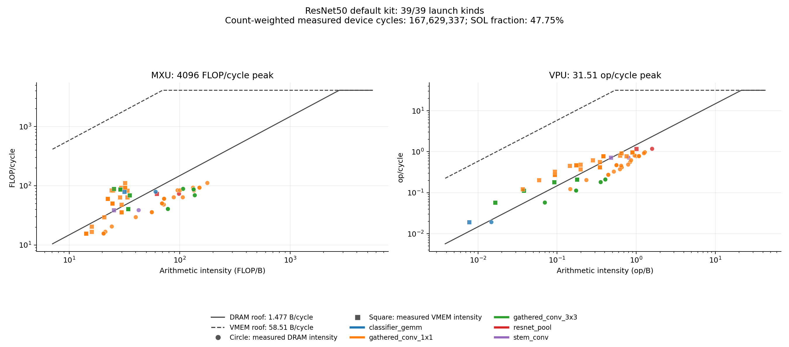

# ResNet50 initial roofline

This initial result covers the existing default ResNet50 kit. ResNet50 is no longer a focus model; no new variants are selected. The inventory has 39 launch kinds representing 55 device launches per inference: 53 convolutions, one maxpool, and one fully connected contraction. Measurements qualify kernel revision `926c6f3248e70d7cfdbf9adb664d7da000ce03f4`; they have not been repeated for subsequent changes. Immutable-weight fast kits are outside this analysis.

| Device cycles | SOL cycles | SOL fraction | Remaining headroom | Kinds measured | Launches represented |
| ---: | ---: | ---: | ---: | ---: | ---: |
| 167,629,337 | 80,044,210 | 47.75% | 87,585,127 | 39 / 39 | 55 / 55 |

Totals are isolated full-launch measurements multiplied by inventory counts, not whole-model latency. Device programs fuse batch normalization, ReLU, and residual additions where applicable. Average pooling, classifier bias, packing, and staging remain host work. Host execution, program loading, launch overhead, runtime completion markers, and whole-model dependencies are excluded.

The inventory covers all 54 convolution and linear contractions: 8,178,368,512 of 8,178,368,512 semantic contraction FLOPs (100%). This counts 2 FLOPs per logical MAC and excludes batch normalization, activation, bias, residual, pooling, packing, and control work. Padded contraction work is 9,222,225,920 FLOPs; official MXU counters additionally reflect launched tiles and conversion work. The default kit ELF matches all 55 launch descriptors, 165 referenced program/input/expected spans, 152 embedded assets, and the 57-node graph. Grouping preserves exact program bytes, geometry, fusion, scales, and traffic rather than merging the 22 physical M/K/N tuples.

## Remaining family headroom

| Family | Kinds | Device cycles x count | SOL cycles x count | SOL fraction | Headroom x count |
| --- | ---: | ---: | ---: | ---: | ---: |
| gathered_conv_1x1 | 25 | 98,942,604 | 49,284,384 | 49.81% | 49,658,220 |
| gathered_conv_3x3 | 11 | 59,024,256 | 24,464,746 | 41.45% | 34,559,510 |
| stem_conv | 1 | 6,617,039 | 4,104,301 | 62.03% | 2,512,738 |
| resnet_pool | 1 | 1,352,407 | 682,184 | 50.44% | 670,223 |
| classifier_gemm | 1 | 1,693,031 | 1,508,595 | 89.11% | 184,436 |

All five families bind on the official DRAM charge. SOL is the largest per-launch resource charge; aggregate fractions divide count-weighted SOL cycles by count-weighted measured cycles. Headroom sums `(measured - SOL) * count` and is a theoretical scheduling upper limit, not expected savings.

Points represent full launch kinds without count weighting. MXU and VPU panels show their respective work. Circles use DRAM intensity against the solid DRAM roof; squares use VMEM intensity against the dashed VMEM roof. Colors identify families. Peaks are 4096 MXU FLOP/cycle, 31.5077 VPU op/cycle, 1.477 DRAM B/cycle, and 58.5143 VMEM B/cycle. The DRAM ceiling assumes the fastest read/write mix. SOL also includes scalar, port, issue, XLU, and LSU limits, which are not additional curves in these panels.

## Method, evidence, and limits

Primary measurements use unmodified npu_model `74982e7c68bd28ba6505b4df37290f198102ccce` `speed_of_light` and `roofline` tools, `DefaultHardwareConfig`, default curve memory, and `numerics="pytorch"`. Both APIs receive the same unchanged dynamic execution memo. The memory curve uses a 42-cycle lead-off, 23.5 cycles per 32-byte load beat, and 21.7 per store beat. The execution-model package is byte-identical to `47b8599`.

Separate RTL-numerics checks match captured expected output bytes and preserve the remaining arena for all 39 representatives: 8 timed checks and 31 functional checks. All 8 timed RTL cycle counts agree with primary measurements. Functional checks make no timing claim. PyTorch-numerics output differs from captured RTL bytes for 38 of 39 kinds; numerical qualification uses the separate RTL checks. Authentication covers all 55 launches, but 39 representatives were freshly checked, not 55 separate executions.

The source analysis is identified as `KPERF-RESNET`; [artifact identifiers](ROOFLINE-MORE.artifacts.json) bind its original report, inventory, provenance, aggregate receipts, validation, and plot by byte length and SHA-256. All 55 launch sources and assembled words regenerate byte exactly from pinned sources, and all 55 protected source pins were unchanged. Full receipts, input arenas, original programs, and execution memos remain retained analysis artifacts outside this checkout. Exact reproduction requires them and the pinned sources and tools; the committed tables and original plot preserve the completed initial result. `make evidence` does not regenerate this roofline.

Timed RTL cycle requalification for the 31 functionally checked kinds, whole-model accuracy and timing, hardware RTL execution, compiler/backend word equivalence, and a kit ELF identity rebuild remain PENDING for this analysis.
